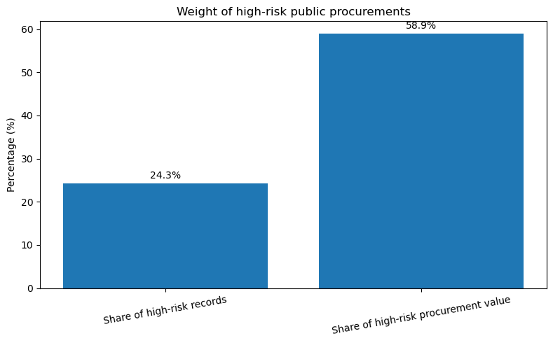
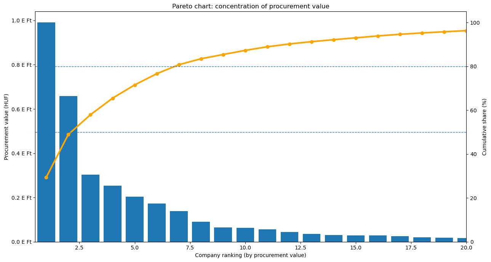
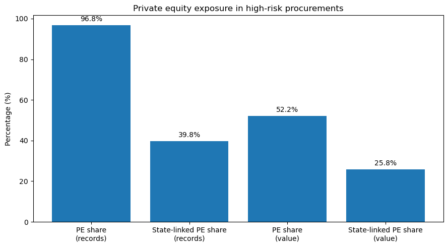

# Public Procurement Risk Analysis

**ELTE Data for Good Hackathon | 2026**

Team-based data analytics project developed for the ELTE Data for Good Hackathon in collaboration with Transparency International Hungary.

**Recognition:** Special Prize for Methodological Innovation.

## Project Overview

This project explores potential risk patterns in Hungarian public procurement through data integration, exploratory analysis, and indicator-based risk scoring.

The analysis investigates how public procurement activity relates to private equity ownership, state investment exposure, repeated contract winners, and buyer concentration.

The objective is to identify procurement records that warrant further investigation, rather than to determine whether corruption or wrongdoing has occurred.

## Technologies

**Language:** Python

**Libraries:** pandas, NumPy, Matplotlib, Seaborn, scikit-learn

**Tools:** Jupyter Notebook, Excel, Git/GitHub

**Techniques:** Data cleaning, relational joins, feature engineering, rule-based scoring, aggregation, and exploratory data visualization.

## Methodology

### 1. Data Preparation and Integration

The analysis uses four related datasets:

- Private equity funds
- Fund managers
- Portfolio companies
- Public procurement records

Data cleaning includes column standardization, date conversion, numeric transformations, and missing-value inspection.

The datasets are joined using company identifiers (DUNS) and fund identifiers (D&B ID) to connect procurement winners with ownership information.

### 2. Risk Indicator Engineering

Four risk indicators are constructed:

- High procurement value
- Repeated winning companies
- Buyer dependency
- A proxy indicator for limited bidding competition

These indicators are combined into an additive risk score and categorized into low-, medium-, and high-risk groups.

The resulting score is a heuristic analytical tool, not a supervised prediction model or a finding of misconduct.

### 3. Exploratory Analysis

The notebook examines:

- Distribution of procurement risk categories
- Private equity and state-investment exposure
- Concentration among leading procurement winners
- Distribution of procurement values
- Temporal patterns in procurement activity

## Visualizations

### Procurement Risk Distribution



### Procurement Value Concentration



### Private Equity Exposure



Additional charts are available in the `ábrák/` directory.

## Findings and Limitations

The exploratory analysis highlights concentration in procurement values and identifies records exhibiting multiple predefined risk characteristics.

The current results require further data-integrity verification. In particular, one-to-many ownership relationships may affect row counts following data integration. Tender-level percentages should therefore be considered preliminary until duplicate counting and join cardinality have been validated.

Risk indicators are signals for further investigation and should not be interpreted as evidence of wrongdoing.

## Repository Contents

- `BayesianBandits.ipynb` — Main Python analysis notebook
- `hackathon_magántőkealapok.xlsx` — Input workbook used in the analysis
- `ábrák/` — Generated charts and visualizations
- Supporting presentation and research documents

## Running the Analysis

1. Clone this repository:

   ```bash
   git clone https://github.com/mekkislimy/elte-procurement-risk-analysis.git
   ```

2. Enter the project directory:

   ```bash
   cd elte-procurement-risk-analysis
   ```

3. Install dependencies:

   ```bash
   python -m pip install pandas numpy matplotlib seaborn scikit-learn openpyxl jupyterlab
   ```

4. Launch Jupyter:

   ```bash
   jupyter lab
   ```

5. Open `BayesianBandits.ipynb` and run its cells sequentially.

The notebook expects the input Excel workbook in the repository's root directory.

## Data Sources and Reproducibility

The analysis uses data supplied for the hackathon. The original data provider, usage terms, and redistribution permissions should be confirmed before treating the included workbook as openly redistributable.

The analysis can be reproduced using the provided workbook and compatible Python dependencies, subject to these data-access conditions.

## Team and Contributions

Developed as a team project for the ELTE Data for Good Hackathon.

**Slim Mekki:** Python-based data preparation, exploratory analysis, risk-indicator implementation, and visualization work represented in this repository.

**Marcell Bakacs:** Preparation of the presentations, writing the code interpretation.

## Author

**Slim Mekki**

[GitHub](https://github.com/mekkislimy) | [LinkedIn](https://www.linkedin.com/in/slim-mekki/)
